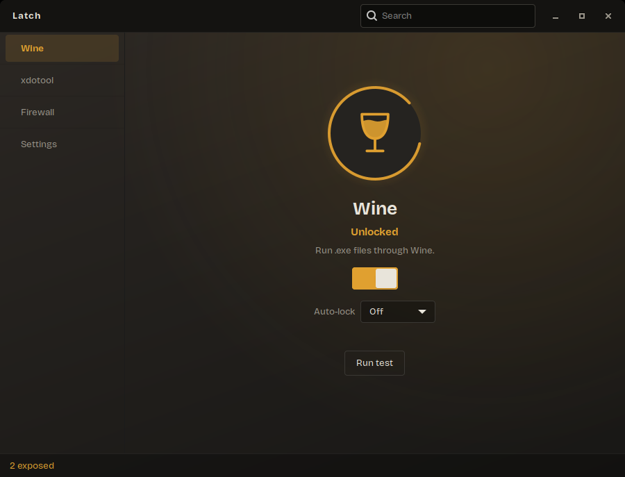
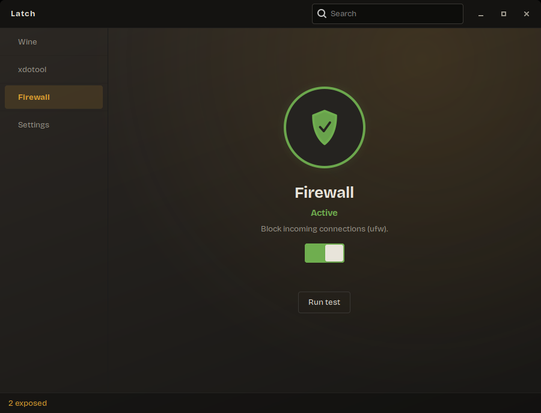
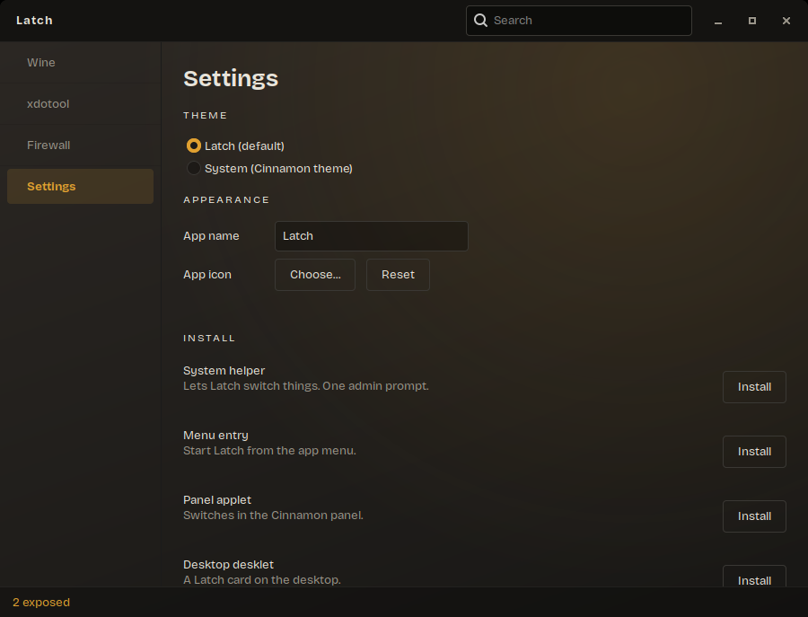

# Latch

[](https://github.com/theamanullahdev/latch/actions/workflows/ci.yml)

A small app for Linux Mint (Cinnamon) that switches three risky things on and off: **Wine**, **xdotool** and the **firewall**.

I am building this right now. It is early. Things will break, and I will change things a lot.

<p align="center">
  
  
  
</p>

## Install

Pick your system:

| Your system | Easiest way |
|-------------|-------------|
| Linux Mint 22+, Ubuntu 24.04+, Debian 13, Kali | **Option 1**: apt repository |
| Arch, Manjaro, EndeavourOS | **Option 2**: install script (or the [PKGBUILD](#arch-linux)) |
| Fedora, openSUSE | **Option 2**: install script |
| Older Mint, Ubuntu or Debian, or anything else | **Option 2**: install script, or [build by hand](#build-from-source) |

Latch is for x86_64 Linux. The main window works on any desktop with GTK3. The panel applet and desklet need Cinnamon. On Hyprland and other Wayland desktops see [below](#hyprland-and-other-wayland-desktops).

### Option 1: apt repository (Debian family)

Add the Latch repository once, then install and update like any other package.

```bash
sudo install -d -m 0755 /etc/apt/keyrings
curl -fsSL https://theamanullahdev.github.io/latch/key.asc | sudo gpg --dearmor -o /etc/apt/keyrings/latch.gpg
echo "deb [signed-by=/etc/apt/keyrings/latch.gpg] https://theamanullahdev.github.io/latch stable main" | sudo tee /etc/apt/sources.list.d/latch.list
sudo apt update
sudo apt install latch
```

The package needs glibc 2.39 or newer, so it is for Mint 22+, Ubuntu 24.04+, Debian 13 and Kali rolling. On anything older (Mint 21, Ubuntu 22.04, Debian 12) use Option 2.

### Option 2: install script (any distro)

This is the "I just found this repo and want to try it" way. It does everything for you.

```bash
git clone https://github.com/theamanullahdev/latch.git
cd latch
extras/scripts/install.sh
```

What it does, and it asks before it starts:

1. Finds your distro and installs the build packages with its package manager (`apt`, `pacman`, `dnf` or `zypper`). This is the only step that uses `sudo`.
2. Checks for Rust 1.85 or newer. If yours is older (Ubuntu and Mint ship 1.75), it installs a private copy with [rustup](https://rustup.rs). Nothing system-wide.
3. Builds Latch (a few minutes) and installs it into `~/.local/bin`, plus a menu entry.
4. Starts it.

Options: `--yes` (no questions), `--no-run`, `--prefix DIR`, `--skip-deps`, `--uninstall`. See `extras/scripts/install.sh --help`.

If your distro is not in the list, it tells you what to install by hand and stops.

### Option 3: one file

Download the `.deb` and its checksum from the [Releases](https://github.com/theamanullahdev/latch/releases) page (Debian family only).

```bash
sha256sum -c SHA256SUMS
sudo apt install ./latch_0.1.0-1_amd64.deb
```

Then start **Latch** from the app menu, or run `latch` in a terminal. In Settings you can add the panel applet and the desktop desklet.

### What is checked, and what is not

| Distro | How it is checked automatically (GitHub builds it on a clean container) |
|--------|-------------------------------------------------------------------------|
| Ubuntu 24.04, Linux Mint 22, Debian 13, Kali rolling | the install script builds and installs it, and the `.deb` installs with `apt` |
| Arch Linux, Fedora, openSUSE Tumbleweed | the install script builds and installs it. On Arch the `PKGBUILD` is built too |

In each case the check ends with `latch status` running, so the program starts and finds all its libraries. **Nobody has opened the window on those distros.** A container has no screen. The only machine I use it on is Linux Mint 22.3 with Cinnamon. If the window misbehaves on your system, please open an issue and say which distro and desktop you have.

### Uninstall

```bash
sudo apt remove latch
sudo rm -f /etc/apt/sources.list.d/latch.list /etc/apt/keyrings/latch.gpg   # if you used option 1
```

If you used the install script, run `extras/scripts/install.sh --uninstall` instead. Before you remove it, open Settings and press **Remove** on the applet and the desklet. Your own settings live in `~/.config/latch`, `~/.local/share/latch` and `~/.cache/latch`. Delete them if you want a full clean up.

**Important:** removing Latch does not undo what it did. If Wine or xdotool is locked at that moment, unlock them first. See the next section.

## Arch Linux

There is a `PKGBUILD` in [`extras/packaging/arch`](extras/packaging/arch/PKGBUILD). It is not on the AUR yet. To build the package yourself:

```bash
sudo pacman -S --needed base-devel git
git clone https://github.com/theamanullahdev/latch.git
cd latch/extras/packaging/arch
makepkg -si
```

If you do not want to deal with `makepkg`, the [install script](#option-2-install-script-any-distro) works on Arch too. On every push, GitHub builds Latch on a real Arch Linux container, runs the tests, and builds this package from the `PKGBUILD`. So I know it compiles and packages on Arch. What I do **not** know is how the window behaves on a real Arch desktop, because I do not run Arch. Tell me if something is off.

## Hyprland and other Wayland desktops

Latch is a GTK3 app, so it should run on Wayland (natively or through XWayland). I have not tried it on Hyprland. A few things to know:

- **Applet and desklet are Cinnamon only.** On other desktops those two Settings buttons stay disabled.
- **Waybar.** There is a terminal command made for status bars. This adds a module that shows `All safe` or `2 exposed`, and opens Latch on click:

  ```jsonc
  "custom/latch": {
    "exec": "latch status --json",
    "return-type": "json",
    "interval": 5,
    "on-click": "latch"
  }
  ```

  ```css
  #custom-latch.safe    { color: #6fae4f; }
  #custom-latch.exposed { color: #e0a030; }
  ```

- **You need a polkit agent running**, for example `hyprpolkitagent` or `polkit-gnome`. Without one, Latch cannot ask for your password.
- **xdotool does not work on Wayland.** The "xdotool" switch locks all the common input tools: `xdotool`, `ydotool`, `wtype` and `dotool`. If you have none of them, the page says "Not found".
- **Terminal commands**, with no window: `latch status`, `latch status --json`, and `latch set wine off` (or `on`, and `xdotool`, `firewall`). Turning something riskier still asks for a password. `latch setup <helper|menu|applet|desklet> <install|remove>` does what the Settings buttons do.

## Security: what Latch changes, and how to undo it

Latch changes system settings, so you should know exactly what it touches.

| Switch   | What it does                                                                        | Undo by hand |
|----------|-------------------------------------------------------------------------------------|--------------|
| Wine     | Lock = `chmod 700` on the Wine program files. Unlock = `chmod 755`.                 | `sudo chmod 755 "$(readlink -f /usr/bin/wine)"` and the same for `wine64` |
| xdotool  | Lock = `chmod 700` on the input tools that are installed (`xdotool`, `ydotool`, `wtype`, `dotool`). Unlock = `chmod 755`. | the loop below |
| Firewall | `ufw --force enable` or `ufw disable`. It never adds, removes or edits your rules. | `sudo ufw enable` or `sudo ufw disable` |

To unlock everything in one go:

```bash
for f in wine wine64 xdotool ydotool ydotoold wtype dotool dotoold; do p=$(readlink -f /usr/bin/$f) && [ -e "$p" ] && sudo chmod 755 "$p"; done
```

Good to know:

- A locked file can still be run by root. Locking only stops normal users, and the agents that run as you.
- If the `wine` or `xdotool` package is upgraded, the new files come back unlocked. Latch shows the real state, so you will see it.
- Making things safer (lock, disable, firewall on) never asks for a password. Making things riskier (unlock, enable, firewall off) does.

What gets installed on the machine:

- `/usr/bin/latch`, the app.
- `/usr/libexec/latch/`: seven small root programs. Six do one fixed job each (`wine-enable`, `firewall-disable` and so on) and take no input. The seventh, `latch-helper`, only installs or removes this set.
- `/usr/share/polkit-1/actions/org.latch.policy`: the rules for which job needs a password.
- A menu entry and an icon.
- In your home folder: `~/.config/latch`, `~/.local/share/latch`, `~/.cache/latch`, and (only if you press Install in Settings) the applet and desklet under `~/.local/share/cinnamon`.

Found a security problem? Please report it privately: open the **Security** tab of this repo and choose **Report a vulnerability**. Please do not post exploit details in a public issue.

## Why I am making this

I build Electron apps on Linux, and sometimes I need Wine to make a Windows `.exe`. Wine is great, but it also lets any `.exe` run on my machine. I do not trust random `.exe` files. So for a while I did something silly: I uninstalled Wine after every build and installed it again the next time.

That got old fast, so I wrote a few shell scripts that lock and unlock Wine ([wine-locker](https://github.com/theamanullahdev/wine-locker)). They flip the execute permission on the Wine binaries. They worked, but they were just scripts in a terminal.

Then a bigger problem showed up. I now let AI agents work on my computer. With a tool like `xdotool` an agent can move my mouse, type on my keyboard and click things, and nobody has to ask me first. I do not want that to be always on. I want to decide when an agent can touch my desktop, and when it cannot.

The same goes for the firewall. I want one place to see it and flip it.

So Latch is a control panel for exactly that: what my machine allows, and what it does not, without me asking first.

## What it is

- A GUI app first. The terminal is not the point.
- Made for Cinnamon. Written in Rust with GTK3.
- One window with a sidebar, one page per switch, and a status bar at the bottom.
- A panel applet and a desktop desklet, so you can see the state without opening anything.
- It has its own look (charcoal, warm gray, amber, no blue, no purple). You can switch to your system theme in Settings.
- Each switch has a **Test** button right under it. It runs the real tool, so you can see if the switch did what it says. For Wine it runs a tiny sample program.
- **Timed unlock** for Wine and xdotool: pick 1 minute to 1 hour and it locks itself again. If you close Latch while a timer runs, it locks early, so an unlock cannot be forgotten.
- A custom app name and icon, in Settings.
- It installs its own pieces from Settings: the helper, a menu entry, the applet and the desklet.

## The password rule

Making your machine safer should be free. Making it riskier should ask for a password.

| Switch   | Safer (no password)   | Riskier (password) |
|----------|-----------------------|--------------------|
| Wine     | lock                  | unlock             |
| xdotool  | disable               | enable             |
| Firewall | turn on               | turn off           |

The password prompt comes from polkit, so it is the normal system dialog. One password covers a short time, so changing a few things at once asks once.

## Where it is today

Early prototype (version 0.1.0, marked as a pre-release). Be careful.

- I have the `.deb` installed on my own Linux Mint 22.3 machine and I use it there.
- I tested the root helper, the whole window, the `.deb` and the timed unlock on a throwaway fake root (a user namespace with stand-in `wine`, `xdotool` and `ufw`). Run the helper checks yourself: `extras/scripts/e2e.sh helper`.
- The polkit rules pass polkit's own validator.
- I have **not** run it on other Mint versions, other desktops, Wayland, or Arch. GitHub builds and tests it on Arch for me, but that only proves it compiles.

Not done yet: a "run this one program with Wine unlocked" button, and per-app rules. See the [CHANGELOG](CHANGELOG.md) for what changed so far.

## Build from source

The install script does all of this for you. By hand:

You need **Rust 1.85 or newer** and the GTK3 development files. Careful: the `cargo` that Ubuntu and Mint ship through apt is 1.75, which is too old. Get a current one from [rustup.rs](https://rustup.rs).

```bash
# Debian, Ubuntu, Mint, Kali
sudo apt install build-essential pkg-config libgtk-3-dev libglib2.0-dev pkexec
# Arch:     sudo pacman -S --needed base-devel gtk3 polkit
# Fedora:   sudo dnf install gcc pkgconf-pkg-config gtk3-devel glib2-devel polkit
# openSUSE: sudo zypper install gcc pkg-config gtk3-devel glib2-devel polkit

git clone https://github.com/theamanullahdev/latch.git
cd latch
cargo run -p latch-app
```

To open a page directly: `cargo run -p latch-app -- settings` (or `wine`, `xdotool`, `firewall`).

The first time you flip a switch, Latch installs a small root helper. That asks for your admin password once. You can remove it again in Settings. (If a package such as the `.deb` put the helper there, use your package manager to remove it. Settings will not touch a package's files.)

To make your own `.deb`:

```bash
cargo install cargo-deb
extras/scripts/pack.sh          # writes target/deb/
```

## How it works, short version

The app runs as you. The few things that need root are done by a tiny helper that only knows six jobs (`wine-enable`, `wine-disable` and so on). Polkit decides which of those jobs need a password. The helper takes no input, so there is nothing to inject into.

More detail is in [lubalab.md](lubalab.md). Design notes are in [docs/design.md](docs/design.md) and the plan is in [docs/prd.md](docs/prd.md).

## License

GPL-3.0-or-later. See [LICENSE](LICENSE).
